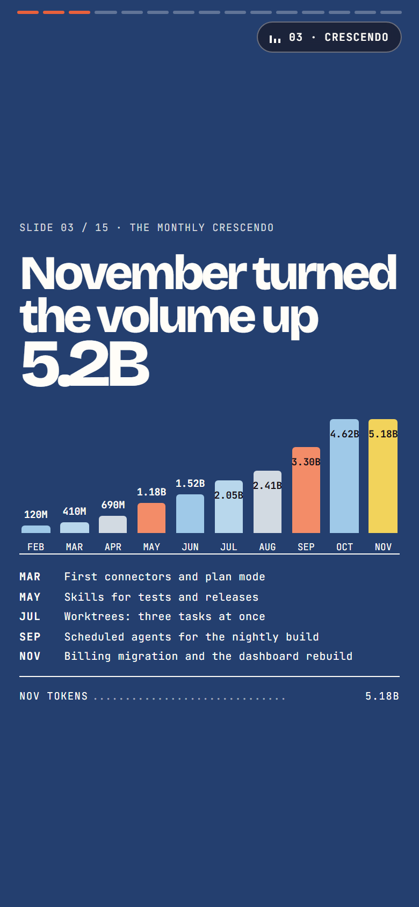
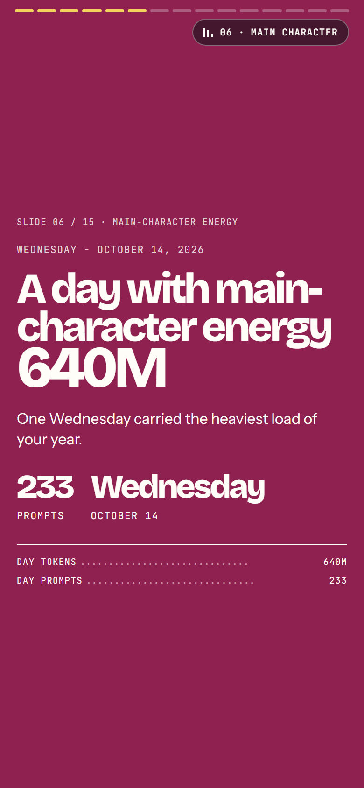
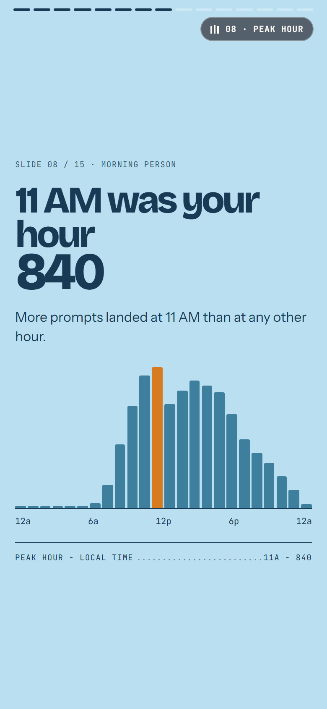
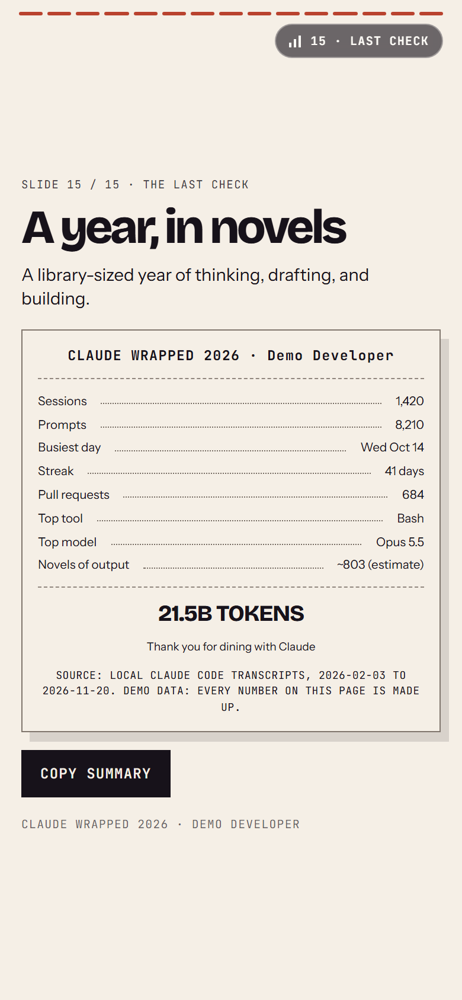

# Claude Wrapped

Your year with Claude Code, as a 16-slide story you can tap through, with its own soundtrack.

It reads the transcripts Claude Code already keeps on your machine and shows your busiest day, longest
streak, peak hour, top tools and models, biggest projects, a few spotlights (your most-typed word, your
latest night, your longest session) and a receipt at the end. Each slide has its own track, generated in
the browser with the Web Audio API: no audio files, nothing to license.

**[See the demo](https://fox-d-e-n.github.io/claude-wrapped/)** (made-up numbers; tap for sound).

<p>




</p>

## Install

It is a [Claude Code skill](https://docs.claude.com/en/docs/claude-code/skills). Copy the folder into your
skills directory:

```bash
git clone https://github.com/fox-d-e-n/claude-wrapped
cp -r claude-wrapped/skills/claude-wrapped ~/.claude/skills/
```

On Windows the folder is `C:\Users\<you>\.claude\skills\claude-wrapped`. Then open Claude Code and say
**"make my Claude Wrapped"**. Claude counts your stats, asks what you built this year, writes a few lines
of story and hands you the page.

Needs Python 3.10 or newer. No packages to install.

## Run it by hand

```bash
cd skills/claude-wrapped/scripts
python wrapped_stats.py --out stats.json            # counts, from ~/.claude/projects
python render.py stats.json story.json -o wrapped.html
```

`story.json` is optional (your name, notes per month, "what you built" cards); `SKILL.md` lists every
key and `examples/demo-story.json` shows one filled in. Useful flags on `wrapped_stats.py`: `--since`,
`--until`, `--root` (another projects folder) and `--ignore-prompt REGEX` (leave hook-generated text out
of the word count).

## Privacy

Everything runs on your machine and nothing is uploaded. The page it builds can show your session
titles, project folder names and most-typed words, so read it before you post it anywhere.
Claude Code deletes transcripts older than its `cleanupPeriodDays` setting, so the recap covers what is
still on disk; the receipt says which dates it counted.

## Change it

- Soundtrack: the `T` table in `skills/claude-wrapped/assets/music.js` sets each slide's track name,
  tempo, key, chords and intensity.
- Slides: `assets/slides.js` builds them from the stats; a slide with no data is left out.
- Look: colours and type are CSS variables at the top of `assets/template.html`.

Checks: `python wrapped_stats.py --selftest` and `python render.py --selftest`.

## License

MIT. Use it, fork it, change it.

Unofficial fan project. Not affiliated with or endorsed by Anthropic or Spotify. "Claude" is a trademark
of Anthropic; "Spotify Wrapped" is a trademark of Spotify.
